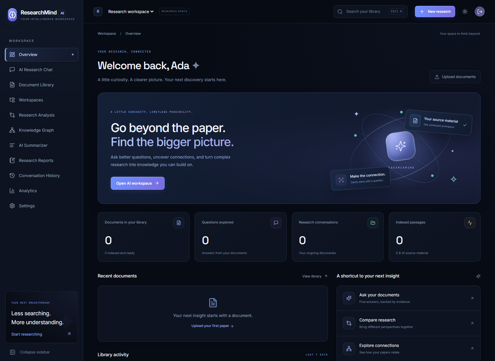

# ResearchMind AI

**Live app: [researchmind-ai-five.vercel.app](https://researchmind-ai-five.vercel.app)**

[Vercel deployment guide](docs/VERCEL_DEPLOYMENT.md)

A document research workspace built with Next.js and FastAPI. Upload source material, ask questions with streamed answers, inspect retrieved passages, compare papers, explore document similarity and export editable research reports. The live deployment uses PostgreSQL/pgvector, Gemini embeddings, private Vercel Blob storage and Vercel Queues. Local development also supports Sentence Transformers and ChromaDB.



Screenshots show the implemented interface with an isolated empty test workspace.

## What works

- Account registration and login with scrypt password hashes, revocable HttpOnly sessions and protected routes.
- Professional signup with emailed six-digit verification codes. Account creation requires successful verification; configure the sender using [Email setup](docs/EMAIL_SETUP.md).
- User-owned research workspaces and authorization on private document, retrieval, conversation, report and source-file APIs.
- PDF, DOCX, TXT and Markdown uploads, extraction, page-aware chunking, embeddings and persistent vector indexing.
- Background uploads with database-recorded processing stages and retry: Vercel Queues in the cloud, or the built-in single-process worker locally.
- Vector retrieval with keyword rescoring, optional cross-encoder reranking, bounded context and conversation memory.
- Actual OpenAI-compatible/Ollama token streaming through SSE. Explicit provider failures, never demo answers.
- Quick, deep, compare, beginner, critical and summary chat modes that change backend instructions and retrieval behavior.
- Source passage cards, original PDF page navigation, conversation resume, copying, stopping, regeneration and Markdown conversation export.
- Dedicated summary and comparison screens, document similarity graph, upload analytics and editable stored reports.
- Nine summary styles, three length budgets, multi-document selection, source passage inspection and explicit long-input truncation notices.
- Rename/delete conversations and empty workspaces; exported reports include the latest editor changes.
- Markdown, paginated PDF and DOCX report downloads with references taken from retrieved sources.
- Responsive layouts, mobile research panels, keyboard search, dark/light themes and reduced-motion support.

The complete list of architectural choices and unfinished capabilities is in [docs/IMPLEMENTATION.md](docs/IMPLEMENTATION.md). In particular, OCR, password recovery, full bibliographic validation and exhaustive literature synthesis are not implemented. Citation labels and source provenance are checked; factual correctness still needs human review. See the [deployment guide](docs/VERCEL_DEPLOYMENT.md) for the live checks and remaining verification limits.

## Stack and architecture

| Layer | Implementation |
| --- | --- |
| Web | Next.js App Router, React, TypeScript, Tailwind, Framer Motion, Lucide, safe React Markdown |
| API | FastAPI, Pydantic, SSE; Python 3.12 on Vercel, Python 3.11+ locally |
| Relational persistence | SQLAlchemy, PostgreSQL on Vercel or SQLite locally, additive Alembic migrations |
| Retrieval | PostgreSQL/pgvector and Gemini embeddings in the cloud; ChromaDB and Sentence Transformers locally; keyword rescoring |
| Files and jobs | Private Vercel Blob and Vercel Queues in the cloud; local files and a single-process worker locally |
| Generation | OpenAI-compatible API, Ollama, existing Gemini/Hugging Face integrations |
| Parsing and export | PyMuPDF, python-docx, plain text/Markdown |
| Validation | Pytest, Playwright, TypeScript, production build, GitHub Actions |

```text
Next.js web UI → same-origin /api proxy → FastAPI
  Upload → validate → extract → chunk → embed → vector store
  Question → scoped retrieval → bounded context → provider stream → source cards
  Users / workspaces / document ownership / conversations / reports → SQLAlchemy
```

The existing `app/`, `web/`, `tests/` structure is retained. `frontend/app.py` is the legacy Streamlit interface and does not implement the new cookie login flow; use Next.js for authenticated research. Optional heavyweight frontend libraries, LangChain, Redis and Celery were not introduced just to match a dependency list. [Implementation details](docs/IMPLEMENTATION.md) explain the substitutions.

## Installation and running locally

Requirements: Python 3.11+, Node.js 22+, and either a generation API key or a running local Ollama model. The project was checked on Windows with Python 3.11 and Node.js 24. Use `npm.cmd` in PowerShell if script execution policy blocks `npm.ps1`.

```powershell
python -m venv venv
.\venv\Scripts\python.exe -m pip install -r requirements.txt
# Copy only if you do not already have .env:
Copy-Item .env.example .env
$env:DEBUG = 'false'
.\venv\Scripts\python.exe -m alembic upgrade head
.\venv\Scripts\python.exe -m uvicorn app.main:app --host 127.0.0.1 --port 8000 --reload
```

In another terminal:

```powershell
cd web
npm.cmd ci
npm.cmd run dev
```

Open http://localhost:3000. Register, open your workspace, upload a document, wait for indexing, then ask a question. API documentation is at http://127.0.0.1:8000/docs. [A shorter quickstart](docs/QUICKSTART.md) is also included.

## Environment and provider configuration

Keep `.env`, `.streamlit/credentials.toml`, uploaded files, databases and model credentials out of version control. No API key is needed in browser code.

| Variable | Purpose |
| --- | --- |
| `LLM_BACKEND` | `openai`, `ollama`, `gemini`, or `local` |
| `OPENAI_API_KEY` | Server-side credential for OpenAI/compatible or existing Gemini integration |
| `OPENAI_MODEL` | Generation model for OpenAI-compatible/Gemini providers |
| `OPENAI_BASE_URL` | Optional OpenAI-compatible endpoint |
| `OLLAMA_BASE_URL` | Local OpenAI-compatible endpoint, default `http://localhost:11434/v1` |
| `OLLAMA_MODEL` | Installed local generation model, default `llama3.2:3b` |
| `EMBEDDING_MODEL_NAME` | Local Sentence Transformers model, default `all-MiniLM-L6-v2` |
| `AUTH_REQUIRED` | Defaults to `true`; disable only for trusted loopback-only legacy local use |
| `PROCESSING_WORKER_ENABLED` | Starts the built-in persistent queue worker; default `true`. Run one API process only. |
| `COOKIE_SECURE` | Set `true` with production HTTPS |
| `CORS_ORIGINS` | Comma-separated permitted frontend origins |
| `DATABASE_URL` | Defaults to `sqlite:///data/documind.db` |
| `CHROMA_PERSIST_DIR` / `UPLOAD_DIR` | Persistent vector and source-file storage |
| `MAX_FILE_SIZE_MB` | Upload size limit, default 50 MB |
| `API_PROXY_URL` | Frontend build-time backend proxy target; default `http://127.0.0.1:8000` |

For local generation:

```text
ollama pull llama3.2:3b
```

```dotenv
LLM_BACKEND=ollama
OLLAMA_BASE_URL=http://localhost:11434/v1
OLLAMA_MODEL=llama3.2:3b
```

Ollama uses its [OpenAI-compatible endpoint](https://docs.ollama.com/api/openai-compatibility). First-time embedding/reranker use downloads model weights. Preload weights to run offline. A small quantized 3B generation model plus embeddings can often run on a machine with 8 GB RAM, but 16 GB is a more practical starting point; CPU generation may be slow. Larger models require substantially more RAM/VRAM. These are planning estimates, not measured performance guarantees.

For paid APIs, choose `LLM_BACKEND=openai`, a valid `OPENAI_MODEL` and your server-side key. A custom compatible service can use `OPENAI_BASE_URL`. OpenAI-compatible APIs, Ollama and Gemini stream text incrementally. Hugging Face currently returns one complete text event. No silent provider fallback is used. Models are shared between ingestion and queries, cached embedding weights load without remote checks, and the worker preloads embeddings at startup. Quick Answer skips optional cross-encoder reranking and limits output to 512 tokens.

## Database setup

`alembic upgrade head` creates new tables while preserving existing metadata. Application startup also creates missing tables for development convenience. The initial migration is additive; it refuses destructive downgrade. Back up `data/` before changes. Legacy documents are not automatically granted to new accounts: re-upload them into an owned workspace.

The Vercel deployment stores metadata and vectors in PostgreSQL and ranks vectors with pgvector. It uses a pooled `DATABASE_URL` for ordinary queries and `DATABASE_URL_UNPOOLED` for processing locks; both are supplied by the connected database. Local development defaults to SQLite and ChromaDB. Existing local accounts and indexes are not transferred automatically. Do not change embedding dimensions in an existing collection: create a new collection and reprocess files. See the [Vercel guide](docs/VERCEL_DEPLOYMENT.md) for cloud setup and verification.

## Testing

```powershell
.\venv\Scripts\python.exe -m pytest -m 'not integration'
# Requires installed/downloadable embedding and reranker models:
.\venv\Scripts\python.exe -m pytest -m integration
cd web
npm.cmd run typecheck
npm.cmd run build
npm.cmd test
```

The API workflow test covers registration → workspace → Markdown upload → extraction/chunking/indexing → retrieval → SSE answer → citation → resumed history → PDF/DOCX export, using real SQL and Chroma with model calls mocked. Security tests check user/workspace boundaries, invalid files, session revocation, cross-origin mutations and safe provider errors. Playwright covers dashboard/search, research controls, mobile panels and login with mocked API responses. Local Playwright uses installed Microsoft Edge; CI installs Chromium. Tests isolate their database and files from your research data.

## Docker and deployment

**Deploy the full app on Vercel:** follow [the Vercel deployment guide](docs/VERCEL_DEPLOYMENT.md).
The root `vercel.json` runs Next.js and FastAPI as Vercel Services on one domain,
with private Blob documents, connected PostgreSQL storage and Vercel Queue jobs.
Import the repository root, not just `web/`, and configure `.env.vercel.example`
values in Vercel's private environment settings. Local indexes and accounts are
not transferred automatically.

**Deploy the complete app as one service:** use the root Dockerfile with the included [Render Blueprint](render.yaml) or [Railway config](railway.json). The website and private Python API share one public URL. Follow [the deployment guide](docs/DEPLOYMENT.md) for private credentials, persistent storage, and the deployment steps. An empty production environment template is included in `.env.production.example`.

For Netlify, use the root `netlify.toml` and follow [the Netlify deployment guide](docs/NETLIFY_DEPLOYMENT.md). The frontend builds from `web/`; set its build-time `API_PROXY_URL` to a separately hosted Python backend's HTTPS origin.

```text
docker compose up --build
```

The web service is available at http://localhost:3000 and API docs at http://localhost:8000/docs. Compose mounts `data/` and a model cache volume. When using local Ollama, the backend container connects through `host.docker.internal`; the host service must be reachable from containers. Containers have not been executed as part of this implementation.

For other hosts, deploy Next.js and the long-running Python backend separately,
or together behind one HTTPS reverse proxy. Build Next.js with `API_PROXY_URL`
set to the reachable backend. Use a same-origin `/api` proxy for cookie
authentication, `COOKIE_SECURE=true`, restricted `CORS_ORIGINS`, persistent storage,
backups, and appropriately limited server access. Add shared rate limiting and
coordinated jobs before scaling the local/Docker setup across multiple workers.
The Next.js image uses [standalone output](https://nextjs.org/docs/app/api-reference/config/next-config-js/output).

## Troubleshooting

- `DEBUG=release` validation error: the host has a non-boolean `DEBUG` variable. Set `$env:DEBUG='false'` before Python commands.
- PowerShell blocks `npm`: use `npm.cmd` or invoke Node directly; no global execution-policy change is needed.
- Login or upload requests fail: check the Python service, proxy target, browser origin and `CORS_ORIGINS`; keep localhost/127.0.0.1 usage consistent.
- Download/model errors: allow the initial model download or preload Sentence Transformers and reranker weights. Provider errors remain errors; the app does not invent replacement answers.
- Scanned PDFs show no text: run OCR preprocessing first. This version does not include OCR.
- No documents after enabling login: old files have no account ownership. Re-upload; the app deliberately does not expose them to the first registrant.
- No source PDF preview: ensure the original source file still exists under `UPLOAD_DIR` and belongs to the logged-in account.
- Build cannot fetch fonts: Next.js needs access to Google Fonts on its first build; a system-font deployment can remove `next/font/google`.
- A stopped answer disappears on reload: aborted partial output is not persisted as a completed answer.

See [implementation status and limitations](docs/IMPLEMENTATION.md) before treating this as production-ready.
